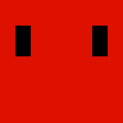
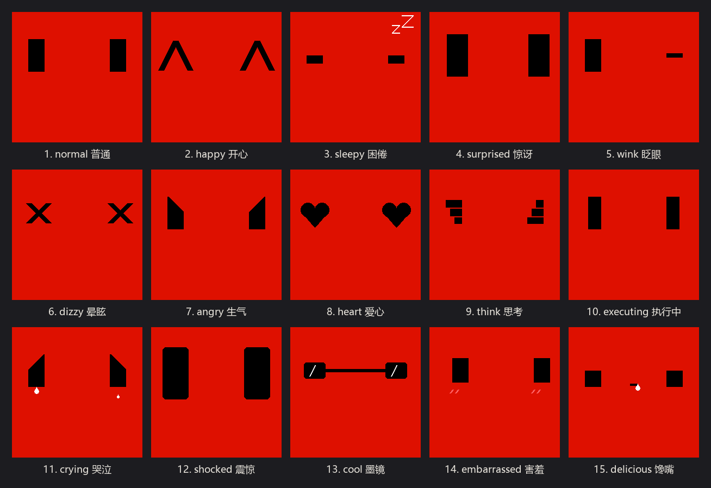

# Clawd Mochi Plus

**An enhanced open-source firmware for the Clawd Mochi desk companion** — 15 parametric geometric expressions, a runtime-adjustable eye geometry engine, an idle life state machine, and zero-config dual-mode WiFi. No bitmap assets, no private config files; open, compile, and flash.

This project is an independent firmware enhancement derived from [yousifamanuel/clawd-mochi](https://github.com/yousifamanuel/clawd-mochi) (MIT). It keeps the original hardware target and instant-on experience while adding a richer expression system for modern AI coding companions.

<p align="center"></p>

- 🇨🇳 中文文档: [README_zh.md](README_zh.md)
- 🎬 Offline preview: open `preview.html` in any browser (no hardware needed)

---

## Features

- **15 expressions, pure math** — every expression is drawn at runtime from `(eyeW, eyeH, eyeGap, eyeOx, eyeOy)` with `Adafruit_GFX` primitives. Zero ROM bitmaps, zero RAM frame buffers.
- **Adaptive geometry engine** — resize/reposition the eyes via the `/eye` HTTP API; all 15 expressions rescale proportionally. Values persist to NVS with an explicit `save=1`.
- **Idle life machine** — randomized blinking (2.5–6 s), random left/right glances (6–15 s), a brief `> <` squint every 30–60 s, and a 5-minute nap (`ZZ` + dozing bars) after inactivity.
- **Dual-mode WiFi, zero config** — boots into the original standalone AP hotspot out of the box (`ClaWD-Mochi` / `clawd1234` / `192.168.4.1`). Uncomment one macro to join your home network with a static IP instead.
- **Built-in web controller** — mobile-friendly page on the device itself: expression pad, geometry sliders, color picker, terminal view, drawing canvas.
- **Offline frame-accurate preview** — `preview.html` replays firmware-rendered frames of all 15 expressions with play/pause and step-frame controls. Pure local, no CDN.

## Hardware

| Part | Detail |
| --- | --- |
| MCU | ESP32-C3 Super Mini (ESP32-C3, 160 MHz) |
| Display | 1.54" ST7789 SPI TFT, 240×240, 3.3 V logic |
| Wiring | SDA→GPIO 10 (MOSI), SCL→GPIO 8 (SCK), RST→GPIO 2, DC→GPIO 1, CS→GPIO 4, BL→GPIO 3, VCC→**3.3 V**, GND→GND |

> ⚠️ **Electrical safety**: the display VCC must go to **3.3 V only** — connecting 5 V can destroy the panel.
>
> ⚠️ **SPI pins**: use GPIO 8/10 for SCK/MOSI. Do **not** use GPIO 6/7 (they are reserved for the SPI flash on many C3 modules and will brick the boot).

3D-printed case: see the original author's model on MakerWorld — [Clawd Mochi physical Claude Code mascot](https://makerworld.com/en/models/2559505-clawd-mochi-physical-claude-code-mascot#profileId-2820000). This repository intentionally ships **no STL/3MF files** — print the original case and drop this firmware in.

## Build & Flash

**Option A — Arduino IDE 2.x**

1. Install the `esp32` board package (Boards Manager URL from Espressif).
2. Install libraries via Library Manager: `Adafruit GFX Library`, `Adafruit ST7735 and ST7789 Library`.
3. Open `clawd_mochi/clawd_mochi.ino`, select board **ESP32C3 Dev Module** with:
   - CPU Frequency: **160 MHz**
   - USB CDC On Boot: **Enabled**
   - Upload Speed: **921600**
4. Flash the firmware.

**Option B — arduino-cli**

```bash
arduino-cli compile --fqbn esp32:esp32:esp32c3:CDCOnBoot=cdc,CPUFreq=160,UploadSpeed=921600 clawd_mochi
arduino-cli upload  --fqbn esp32:esp32:esp32c3:CDCOnBoot=cdc,CPUFreq=160,UploadSpeed=921600 -p COM<port> clawd_mochi
```

No configuration file is required for a default build — it comes up as an AP hotspot. There is no `#error` gate and no `wifi_config.h` to create.

## Expressions

15 expressions, driven from HTTP (`/cmd?k=<key>`) or the built-in web controller.

<p align="center"></p>

| # | Expression | Key | Alias | Frames | Frame period | Behavior | Typical use |
| :-: | --- | :-: | :-: | :-: | :-: | --- | --- |
| 1 | Normal | `w` | `w` | 1 | — | persistent view, reacts to idle blink/glance | idle / standby |
| 2 | Happy | `h` | `h` | 1 | — | holds, auto-restores | praise / success |
| 3 | Sleepy | `z` | `z` | 2 | 600 ms | loops; dozing bars + rising `zZ` | late night / wind-down |
| 4 | Surprised | `o` | `o` | 5 | 60 ms | one-shot shake, enlarged eyes | listening / startled |
| 5 | Wink | `k` | `k` | 1 | — | holds, auto-restores | playful moment |
| 6 | Dizzy | `x` | `x` | 5 | 60 ms | one-shot sway, `X X` eyes | error / stuck / confusion |
| 7 | Angry | `g` | `g` | 1 | — | holds, auto-restores | warning |
| 8 | Heart | `l` | `l` | 2 | 250 ms | loops, pulsing heart eyes | task success / reward |
| 9 | Think | `t` | `t` | 4 | 140 ms | loops, flowing wave bars | analysis / reasoning |
| 10 | Executing | `e` | `e` | 3 | 200 ms | loops, both eyes erode inward | code running / tool call |
| 11 | Crying | `c` | `crying` | 4 | 200 ms | loops, alternating teardrops | serious failure |
| 12 | Shocked | `b` | `shocked` | 2 | 90 ms | loops, oversized jittering eyes | unexpected result |
| 13 | Cool | `v` | `cool` | 2 | 350 ms | loops, sunglasses + moving glare | build passed / shipped |
| 14 | Embarrassed | `m` | `embarrassed` | 2 | 400 ms | loops, averted gaze + blush | permission request / shy |
| 15 | Delicious | `y` | `delicious` | 4 | 200 ms | loops, drooling drip | food / treats |

**Squeeze eyes (`s`)** — the classic `> <` view — is a **separate always-on view**, not part of the 15-expression set. It stays on screen until you switch away.

`/cmd?k=` also accepts view keys: `s` squeeze-eyes view, `d` terminal view, `q` leave the terminal, `i` WiFi info page, `a` replay the logo animation, `n` silently return to normal eyes without leaving the current view.

Temporary expressions auto-restore after 5 s (Think: 6 s); pass `/cmd?k=t&hold=30000` (500–600000 ms) to hold longer.

## REST API

Base URL: `http://192.168.4.1` (AP) or your configured static IP (STA). All endpoints below return JSON.

| Endpoint | Purpose |
| --- | --- |
| `/cmd?k=<key>` | Trigger an expression key or alias (see table above). Optional `hold=<ms>` for temp expressions. `busy:1` in the reply means a blocking animation is playing. |
| `/eye?w=&h=&gap=&ox=&oy=` | Adjust eye width/height, center distance, and X/Y offset. Add `save=1` to persist to NVS; `reset=1` restores defaults. |
| `/state` | Current view, expression, idle/backlight flags, eye geometry, animation background (`bg`), WiFi mode (`ap`/`sta`), IP, RSSI (STA only), free heap. |
| `/idle?on=1\|0` | Enable/disable the idle life machine (persisted immediately). |
| `/speed?v=1\|2\|3` | Animation speed: 1 = slow (default), 2 = normal, 3 = fast. |
| `/backlight?on=1\|0` | Screen backlight on/off. |
| `/redraw?bg=<RRGGBB>` | Set animation background color and redraw. |
| `/canvas`, `/draw/clear`, `/draw/stroke` | Freehand drawing canvas (used by the web controller). |
| `/char` | Render a single character (web console view). |

Example:

```bash
curl "http://192.168.4.1/cmd?k=crying"
curl "http://192.168.4.1/eye?w=36&h=72&gap=128&oy=36&save=1"
curl "http://192.168.4.1/state"
```

## Drive it from Claude Code (example)

Any HTTP client can drive the face:

```bash
curl "http://192.168.4.1/cmd?k=e"   # executing
curl "http://192.168.4.1/cmd?k=l"   # heart — all done
```

`examples/clawd-notify.py` maps Claude Code hook events to faces. Suggested mapping (edit to taste):

| Claude Code hook event | Key | Face |
| --- | :-: | --- |
| `UserPromptSubmit` | `t` | think |
| `PreToolUse` | `e` | executing |
| `PostToolUseFailure` | `x` | dizzy |
| `SubagentStart` | `t` | think |
| `PermissionRequest` | `m` | embarrassed |
| `Stop` | `l` | heart |
| `StopFailure` | `c` | crying |
| `SessionEnd` | `n` | back to normal |

Wire it into your Claude Code `settings.json` (`hooks` section), e.g. for every tool call:

```json
{
  "hooks": {
    "PreToolUse": [
      { "matcher": "*",
        "hooks": [ { "type": "command",
                     "command": "python /path/to/examples/clawd-notify.py", "timeout": 5 } ] }
    ]
  }
}
```

Set the `CLAWD_URL` environment variable if your device is not at the default AP address. The script never blocks Claude Code: 2 s network timeout, all connection errors ignored.

## WiFi Modes

**Default — standalone hotspot (no configuration)**. The device boots into AP mode:

- SSID `ClaWD-Mochi`, password `clawd1234`, page at `http://192.168.4.1`

**Optional — home network (STA with static IP)**. In `clawd_mochi.ino`, uncomment `#define ENABLE_HOME_WIFI` and fill in:

```cpp
#define WIFI_SSID   "Your-WiFi-SSID"
#define WIFI_PASS   "Your-WiFi-Password"
#define SCREEN_IP   192,168,1,200
#define SCREEN_GW   192,168,1,1
#define SCREEN_MASK 255,255,255,0
#define SCREEN_DNS  192,168,1,1
```

STA notes: 2.4 GHz networks only; pick a static IP outside your router's DHCP pool; boot waits up to 15 s for DHCP then falls back to AP if the connection fails; once connected, a 10 s watchdog reconnects on drop and never falls back to AP again.

## Offline Preview (`preview.html`)

Double-click `preview.html` — a single-file HTML5 player with every expression pre-rendered frame-by-frame from the firmware. Play/pause, single-frame stepping, per-expression frame counts and periods. Completely local: no CDN, no build step, no network requests.

Note: frames are pre-generated PNG matrices, so they do not react to `/eye` geometry changes — for live geometry tuning use the device's built-in web controller.

## Project Layout

```text
clawd-mochi-plus/
├── clawd_mochi/
│   └── clawd_mochi.ino        # complete firmware (single file)
├── examples/
│   └── clawd-notify.py        # Claude Code hook → expression bridge (example)
├── docs/images/               # README figures (rendered from firmware frames)
├── preview.html               # offline expression frame player
├── .github/workflows/compile.yml   # CI: compiles the firmware on every push
├── CHANGELOG.md
├── LICENSE                    # MIT (original + Plus contributors)
└── README.md / README_zh.md
```

## Credits & License

- Original project: [yousifamanuel/clawd-mochi](https://github.com/yousifamanuel/clawd-mochi) — hardware design, base firmware, 3D case ([MakerWorld](https://makerworld.com/en/models/2559505-clawd-mochi-physical-claude-code-mascot#profileId-2820000)).
- Clawd Mochi Plus: expression engine, adaptive geometry, idle state machine, dual-mode WiFi, offline preview.

MIT — see [LICENSE](LICENSE).
